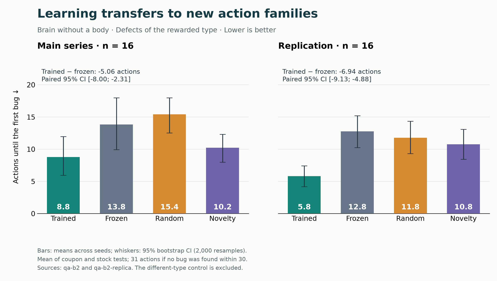
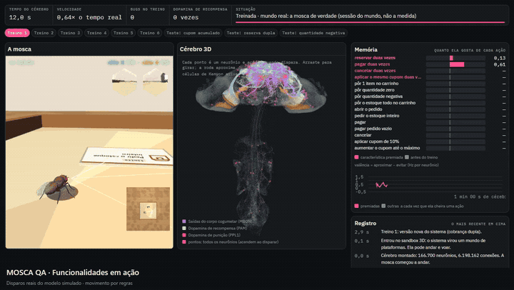

# A fruit fly simulated from its complete connectome learns to look for software bugs

**Dopaminergic conditioning in the mushroom body of an integrate-and-fire model of the Male CNS v1.0, from the isolated
brain to a body in a 3D world**

Jonnas Figueiredo · version of 2026-10-12 · *[Versão em português](artigo.md)*

> **[Figure 1: overview.]** Suggestion: on the left, the 3D brain with Kenyon cells and output neurons lit; on the
> right, the fly in the 3D arena smelling the three plaques. Caption: "The same brain, without a body (bench) and with a
> body (arena)."

---

## Abstract

We simulated the complete central nervous system of a male *Drosophila melanogaster* (Male CNS v1.0, Janelia, 2026:
166,700 neurons and 6.2 million connections), with integrate-and-fire neurons (Shiu et al., 2024) and learning by
dopaminergic depression of mushroom body synapses. Each action of a fictional software system is presented as an odor;
each bug found is paired with reward dopamine. We asked whether the trained brain then prioritizes, in parts of the
system it has never seen, the actions that share the rewarded feature.

**Brain without a body.** In a protocol validated beforehand by brain-free simulation and power analysis, the trained
fly found bugs of the learned kind in new action families 5.1 actions earlier than the frozen-weights control (95% CI
[−8.0; −2.3], 16 seeds) and 6.9 actions earlier in the replication ([−9.1; −4.9], 16 seeds). The effect survived 180 s
of other odors, held for another kind of bug and withstood Holm correction over 16 series. It did not help with a bug
of another kind, the dissociation expected from a specific association.

**Fly with a body.** In a simulated body that walks and smells with its antennae in a 3D arena, the same training made
the fly choose actions of the rewarded kind more often in new parts of the system: +0.10 choice fraction (95% CI [0.05;
0.15], p < 0.001, higher in 16 of 20 seeds), with the valence of the rewarded odor higher in 19 of 20. Time to the first
bug, the primary criterion written beforehand, did not decrease measurably (−1.2 attempts, [−5.9; 3.4]): memory changes
the choices, but too little to shorten the search with 20 pairs.

We report every series, including 11 negative ones, each with its identified cause, and always separate what emerges
from the measured wiring from what is a model rule.

---

## 1. Introduction

### 1.1 Motivation

Complete connectomes make it possible to simulate a whole brain from its measured wiring. Shiu et al. (2024) showed that
an integrate-and-fire model of the adult fly brain predicts feeding and grooming circuits without per-neuron tuning. The
Male CNS v1.0 extends the map to the entire central nervous system of a male.

The applied question is deliberately playful: can a simulated fly learn to "hunt bugs"? The scientific question is
serious: does the mushroom body associative learning circuit, wired as in the real fly, link an abstract feature of a
stimulus to a reward and transfer that association to new stimuli that share the feature? And does this survive when
the brain lives in a body, sensing the world through its own senses?

### 1.2 The mushroom body

Odors activate olfactory receptors grouped into about 50 glomeruli. Projection neurons carry this code to the ~2,000
Kenyon cells (KCs) per side, which respond sparsely (5–10% per odor; Honegger et al., 2011; Lin et al., 2014). KCs
converge onto a few dozen output neurons (MBONs), in compartments innervated by distinct dopaminergic neuron types (Aso
et al., 2014). Reward (PAM) or punishment (PPL1) dopamine depresses the KC→MBON synapses active at that moment (Hige et
al., 2015), changing the response to that odor.

### 1.3 Contributions

1. A training and test protocol for a brain simulated from the connectome, with paired controls, criteria written
   beforehand and replication.
2. In the isolated brain, a demonstration of specific learning and feature-based transfer.
3. The same question in a 3D body: memory transfers to the choices of a fly that walks and smells.
4. A methodological lesson useful beyond this project: validate the task with a brain-free "oracle", a power analysis
   and a short conditioning test before spending expensive simulations.
5. A complete record of negative results and their causes.

---

## 2. The model

### 2.1 Overview

The model is faithful to the animal in its **wiring** and simplified in its **neurons**.

| Layer | What it is | Source |
|---|---|---|
| Map | 166,700 neurons, 6.2 million connections with 5+ synapses; sign from the predicted neurotransmitter | Male CNS v1.0 |
| Neuron | Leaky integrate-and-fire, 0.25 ms step, event-driven simulation | Shiu et al. (2024) |
| Synapse | Weight proportional to the synapse count | Map |
| Inputs | Spike trains into real sensory neurons (olfactory receptors per glomerulus, leg sugar neurons, LC10a) | Map + rule |
| Outputs | Rates of real command neurons (steering DNa01–03, proboscis, giant fiber, wings, MBONs) | Map |
| Learning | Dopaminergic KC→MBON depression | Rule (Hige et al., 2015) |

**Global calibrations** (needed because the map has more than twice the synapses of the 2024 one; without them, the
whole brain fires at once): synaptic gain 0.5×; adaptation of 0.3 mV per spike (τ 1 s); no PN↔LN excitatory connections
in the antennal lobe; no autapses; tone of 6.8 mV in MBONs and 7.3 mV in DNa01–03. No individual weight was tuned to
produce behavior.

### 2.2 Learning and memory

- **Trace:** each KC that fires leaves a ~0.4 s trace ("who was smelling the odor").
- **Reward:** the 222 PAM neurons depress the synapses from KCs with a trace onto avoidance MBONs (`mbon_evitar_rec`).
  Punishment: the 12 PPL1 neurons depress the synapses onto approach MBONs.
- **Time:** forgetting back to the original weight (τ 90 s by default; 1 h in the embodied measurements, section 7),
  consolidation (each dopamine episode makes the change up to 10× more stable) and extinction (smelling without reward
  erases faster).
- **Main control:** the same brain, with the same exposure and the same rewards, but with frozen weights
  (`plasticidade: false`).

**Readout (rule):** valence = rate of `mbon_aprox` − mean(`mbon_evitar`, `mbon_evitar_rec`), in Hz per neuron, 1 s
average. The noise of this readout with frozen weights is 0.15 (standard deviation).

### 2.3 How close to the real fly

**Emerging from the wiring** (screens of the model itself): feeding (sugar on the legs → proboscis, first signal at
30 ms), visual orientation (LC10a → same-side DNa02), escape (looming threat → giant fiber burst; DNp02, DNp04 and DNp11
set the direction) and associative learning specific to the paired odor.

**Memory, compared with the animal's:**

| | Real fly | Model |
|---|---|---|
| KC→MBON circuit, PAM/PPL1 dopamine | yes | yes, from the map |
| Rule (depression of active synapses) | measured (Hige et al., 2015) | implemented |
| Compartments | ~15, with distinct roles | grouped into approach/avoid |
| Duration | hours (short term) to days (long term) | single configurable forgetting + consolidation |
| Extinction | new, opposing memory (Felsenberg et al., 2018) | erases the original |

**Limits:** single-compartment neurons, no retina (vision enters at LC10a through a rule), no broad neuromodulation or
gap junctions, KCs sparser than in the animal (~3% per odor versus 5–10%). In one sentence: the circuit and the learning
rule are the fly's; memory time courses are simplified. We do not claim the model is a fly.

---

## 3. Method

1. **Criterion before measurement.** Each series has its criterion written in `docs/plano-treino-robusto.md` and
   committed to git before running; the history proves the order.
2. **Pairing by seed.** All conditions of a seed see the same sequence of visible actions, drawn beforehand.
3. **Controls:** frozen (main), random choice, novelty explorer, and a control bug that memory should not help find.
4. **Statistics:** paired difference per seed; 95% CI by percentile bootstrap (2,000 resamples); p from the same
   bootstrap; dz.
5. **Replication** with new seeds; **Holm correction** over the family of confirmatory series.
6. **Declared design changes,** motivated by diagnostics independent of the main result, with new seeds and criteria.
7. **Negative results published** with the same detail.

Execution: the brain without a body runs in Node.js with the same code as the page (`web/sim-worker.js`); the fly with a
body runs in the page, in headless Chrome, with its real eyes. Automated routines execute ladders written beforehand,
summarize, log to the diary and commit (`scripts/madrugada.mjs`, `scripts/madrugada_mundo.mjs`).

---

## 4. Task: bug hunting as olfactory conditioning

**The system** (`web/qa/pedidos.js`): an in-memory Orders system (stock, cart, charges, cancellations, coupons), with
bugs injectable per version and a contract checker that does not know where the bug is (stock between 0 and the
initial value, stock conservation, one charge per order, finite total ≥ 0, no negative quantity accepted, discount
≤ 30%). The correct version raised no false alarm in 90,000 random actions.

**Actions as odors (our metaphor):** the 15 actions combine a family (cart, stock, payment, cancellation, coupon) and an
input (normal, zero, limit, negative, repeated). Each of the 10 features is a pair of glomeruli, and an action's odor is
the union of the four, at 100 Hz on both antennae.

**Choice and reward (rules):** at each step, 3 of the 15 actions are visible; the fly smells each for 1 s and chooses by
softmax (T = 0.15) over valence. A contract violated for the first time (new bug) is paired with the action's odor and
PAM at 100 Hz. Training uses versions with repetition bugs in payment and cancellation; the test, without reward, uses
new families (double coupon, double reservation) and a control (negative quantity).

**Primary metric:** actions until the first bug in the transfer versions (31 if not found in 30); trained − frozen < 0.

> **[Figure 2: the protocol.]** Suggestion: training → test diagram, showing the families with bugs in training and the
> new families in the test, linked only by the "repeated" feature.

---

## 5. Validating learning

**T0, isolated brain** (`t0-cerebro.json`, 3 seeds): paired with dopamine, odor A had its `mbon_evitar_rec` response
reduced by 65% (−0.9 to −1.1 Hz) and its valence rose from ~0.7 to ~1.4; unpaired odor B and the frozen brain did not
change.

**T1, two-odor arena with a body** (20 sessions): preference for the rewarded cue, trained − frozen, **0.74 (95% CI
[0.65; 0.82], 5/5 seeds)**.

---

## 6. Results in the brain without a body

### 6.1 From negative results to a validated design

The first five series were negative. The investigation found two causes, both in the design and not in the brain:

| Cause | Evidence | Fix |
|---|---|---|
| Odors that lit few KCs | up to 8 pairings raised valence only +0.1 to +0.2 (noise); the rewarded action lit 38 KCs | remap the rewarded feature to strong glomeruli (DC1+VA6, ~90 KCs): **one** reward then raised valence by +0.74 to +0.92 |
| Insensitive task | a brain-free oracle showed that even perfect memory would only gain 3.8 actions, and one test version was nearly unreachable | bench 2: repetition bugs with no precondition, test in new families, task control, test without reward |

Bench 2 was validated before any run: in the oracle, random 13.2 actions, perfect memory 6.2, memory with the gain
measured in the brain 8.4–8.8; 16 seeds detect the smallest measured gain in 92% of simulations.

### 6.2 Main result: passed and replicated

Actions until the first bug (lower is better), 16 seeds per series:

| Series | Trained | Frozen | Random | Novelty | Trained − frozen (95% CI) |
|---|---|---|---|---|---|
| Main | **8.8** | 13.8 | 15.4 | 10.2 | **−5.06 [−8.00; −2.31]** |
| Replication | **5.8** | 12.8 | 11.8 | 10.8 | **−6.94 [−9.13; −4.88]** |

- Valence of repeated actions rose +1.03 and +0.95; other actions and the frozen brain stayed at ~0.
- The trained fly chose a repeated action in 85% of opportunities, versus 53% for the frozen one.
- **Dissociation:** in the control (a bug of another kind) the trained fly did not improve; it got worse (+3.7 and
  +8.3). It learned "repetition means bugs", not "find anything faster".

### 6.3 Robustness

| Extension (16 seeds per series, with replication) | Main | Replication |
|---|---|---|
| Retention: 180 s of other odors before the test | −4.8 [−8.3; −1.7] | −5.6 [−8.9; −2.5] |
| Another rewarded kind of bug ("normal") | −4.8 [−7.3; −2.4] | −5.1 [−8.0; −2.4] |
| Odor control: rewarded feature on weak glomeruli | −2.1 [−5.4; +1.3], negative | — |
| Disappointment (PPL1 when a promising choice finds no bug), cost in the control | +6.3 [+1.7; +11.6] | +4.6 [−0.6; +10.6], **did not replicate** |

With Holm over the 16 confirmatory series, the 6 positive series that replicated remain significant (p 0.007–0.011).

### 6.4 Baseline and curiosity

**Against a classic learner** (Rescorla–Wagner with the same information): the fly transfers better (−5.3
[−7.5; −3.2]) and comes close to the ceiling, like a learner that only learns from reward and generalizes by feature; it
pays more on a bug of another kind.

**Memory + habituation** (our rule: valence − 2.5 × attempts of the action in the episode): ties with the novelty
explorer on the average over all bugs (−0.2 and −0.3 actions; pre-registered non-inferiority, replicated), beats it on
bugs of the learned kind (−1.6 and −2.1) and loses on the other kind (+2.7 and +3.5). In this arrangement, memory's own
contribution was small.

---

## 7. The fly with a body in the 3D world

### 7.1 Body and world

The body is NeuroMechFly (flygym, MuJoCo), driven by the brain's outputs: the steering descending neurons turn the fly,
the wing motor neurons command flight, the proboscis extends with sugar on the legs. Each eye has 721 ommatidia and the
LC10a receptive fields come from the synapses. The world is a kitchen counter in 3D; the 15 actions become plaques with
the odor of their features.

> **[Video 1: the fly in the 3D world.]** Suggestion: 30–60 s of the fly walking, climbing and flying between the
> kitchen platforms, with the 3D brain lighting up beside it.

### 7.2 Platform worlds: negative results, with causes

| World | Result | Cause found |
|---|---|---|
| Platforms by family, free walking and flight (20 pairs) | negative: fraction of tastings on the rewarded feature 0.26 (trained) versus 0.28 (frozen), at chance (0.27) | on a platform the fly tastes every plaque, and the rewarded feature was on 4 of 5 platforms: memory had nowhere to become a choice |
| Platforms by feature (6 calibrations) | training without enough reward (≤ 3 of 9 versions with a bug) | platform shape and an **innate aversion to the DC1+VA6 odor** (0% of time on the platform carrying it; 16% with the swapped map), coming from the brain, decided where it went |

### 7.3 Choice arena and the conditioning diagnosis

To isolate choice, we followed the design of memory tests with real flies (T-maze, choice arenas) and that of the bench:
in each attempt, 3 plaques on the floor around the center (the same visible actions as the bench for the same seed). The
fly walks to each one (**rule:** the path to the next adds a turn toward it), stops for 1.5 s on top smelling with its
antennae (valence is the MBON average over the last 1 s) and, after the three, the bench's choice rule lights up the
chosen one, which it tastes with its proboscis.

The first arena series (20 pairs) was negative (+0.5 attempts [−3.6; +4.7]). Before any new series, short conditioning
tests in the world (`qa_condicionamento.mjs`: the fly standing on a plaque, 3 pairings, valence measured before and
after) found the causes:

| Condition (2 seeds each) | Valence change 20 s later | 200 s later |
|---|---|---|
| Swapped odor map (the one used), forgetting 90 s | +0.11 / +0.08 | −0.13 / −0.03 |
| **Strong odors, forgetting 1 h** | **+0.83 / +0.93** | **+0.57 / +0.86** |
| Strong odors, forgetting 90 s | +0.68 / +0.53 | +0.24 / +0.26 |
| Frozen | −0.16 to +0.07 | −0.06 to +0.15 |

The odor at the antennae during pairing was the bench's (98 Hz on all four glomeruli); vision and the sweet taste were
ruled out. The swapped map also barely learns in the brain without a body (+0.03). Fixes: strong odors (as in the
bench) and 1 h forgetting (a declared model parameter; real flies remember a sugar reward for hours). A 4-pair
mini-arena showed higher choice in 3 of 4 seeds before the long series.

> **[Figure 4: the arena.]** Suggestion: top view of the tray with the three plaques and the fly's path in one attempt
> (smell, smell, smell, taste).

### 7.4 Result with a body (arena 2, 20 pairs, criterion written beforehand)

Bench 2 protocol (training of 6 versions × 20 attempts; test on 3 new versions, without reward, until the first bug or
30 attempts), strong odors, 1 h forgetting, seeds 1601–1620.

| Trained − frozen | Difference | 95% CI | p | dz | Seeds in favor |
|---|---|---|---|---|---|
| Attempts until the first bug in transfer (**primary**) | −1.15 | [−5.92; +3.40] | 0.65 | −0.11 | — |
| **Choice of the rewarded feature when visible** | **+0.10** | **[+0.05; +0.15]** | **< 0.001** | **0.81** | **16 of 20** |
| Valence of rewarded options in the test | +0.13 | [+0.09; +0.18] | — | — | 19 of 20 |
| Control (should not improve) | +2.5 | [−1.95; +6.95] | 0.31 | 0.24 | — |
| Bugs found in training | +0.2 | [−0.95; +1.30] | 0.74 | — | — |

- **The primary criterion did not pass.** The trained fly did not find the first new bug measurably sooner.
- **Memory transferred to the choices:** in parts of the system it had never seen, the embodied fly chose actions of the
  rewarded kind more often (0.36 versus 0.26), and its brain valued that odor more. Both conditions received the same
  amount of reward in training.
- This second result was secondary in the registration; to count as a finding of its own it needs a confirmatory
  series in which it is the primary criterion, with replication.

> **[Figure 5: choice with a body.]** Suggestion: paired points per seed (trained × frozen) of the rewarded-feature
> choice fraction, with the y = x line.
>

[Watch the video: features in action](videos/funcionalidades-arena.mp4) — 24 s, 720p, dark theme; playback at approximately 1.5× recorded wall time.

### 7.5 Why the effect is smaller with a body

| | Bench without a body | Arena with a body |
|---|---|---|
| Valence of the rewarded odor after training | +1.03 | +0.13 |
| Choice of the rewarded feature | 85% versus 53% | 36% versus 26% |
| Pace | ~5 s per choice | ~20 s per attempt |
| Background from the other senses | none | eyes, touch, legs (KCs ~140 Hz background) |

Right after a reward, valence rises as much as in the bench (+0.8 to +0.9). Over a session, the slower pace, the many
unrewarded smells (which the model's extinction erases) and the background from the other senses reduce the average
gain. With a smaller effect, choice improves, but too little to shorten the time to the bug with 20 pairs.

---

## 8. Discussion

### 8.1 What can be claimed

- **The circuit learns specifically,** with a single reward, and transfers the association by feature.
- **Without a body,** this transfer makes the fly find bugs of the learned kind 5–7 actions sooner, robustly (retention,
  another kind of bug, replication, Holm), at a cost on a bug of another kind.
- **With a body,** the transfer appears in the choices of the walking, smelling fly (p < 0.001, 16 of 20 seeds), but a
  time gain was not demonstrated.
- **Cue strength matters:** odors that recruit few KCs barely learn, with or without a body.

### 8.2 Methodological lessons

- A negative result can come from the design, not the brain: stimulus coding, task sensitivity and, with a body, the
  world design hid effects that existed.
- Validating the task with a brain-free oracle, a power analysis and a short conditioning test **before** long series
  would have saved days of simulation.
- A world with a body brings biases the isolated brain does not have: innate aversions, attraction to light, object
  geometry. They must be measured and controlled like any other variable.

### 8.3 Threats to validity

- **Several designs tested.** Mitigated by criteria written beforehand, new seeds at every change, replication and
  Holm, but the risk of a "garden of forking paths" exists and is documented step by step.
- **Our rules along the way:** actions as odors, valence readout, softmax and, with a body, the guided path in the
  arena. The result shows that the map's circuit **supports** transfer under these rules, not that a real fly would hunt
  bugs.
- **The same connectome for every seed:** there is no between-individual variability.
- **Forgetting parameter** changed for the embodied measurements (90 s → 1 h), declared and motivated by a conditioning
  test.
- **Limited practical use:** as a tester, the fly does not beat a novelty explorer on the average over all bugs.

### 8.4 Next steps

1. **Confirm the embodied effect** in a series with choice as the primary criterion, with replication.
2. **More faithful memory:** real mushroom body compartments and extinction as an opposing memory (Felsenberg et al.,
   2018), validated first without a body.
3. **A larger embodied effect** (more visible actions, longer training) to try to gain search time.
4. **Real software** with bugs generated by mutation testing; sequence bugs; memory across sessions.

### 8.5 Conclusion

In a model of the complete central nervous system of a male *Drosophila*, the mushroom body circuit, conditioned with
dopamine for every bug found, learns the feature of the actions that revealed bugs and transfers it to parts of a system
it has never seen. Without a body, this shortens the search robustly and reproducibly. In a body that walks and smells,
the same memory changes the fly's choices, but not yet enough to shorten the search.

We do not claim that a real fly would look for bugs, that the model is a fly, or that the method beats conventional
testing. We claim that the measured wiring of a real brain, with simplified neurons, supports associative learning and
transfer in a task that has nothing natural about it, and we report where this works and where it does not yet.

---

## 9. Reproducibility

| What | How |
|---|---|
| Brain data | `web/data/`, generated from male-cns.janelia.org by `scripts/01_filter_edges.py` and `02_build_web.py` |
| Brain validation (T0) | `node scripts/t0_cerebro.mjs 29,101,202` |
| Series without a body | `node scripts/qa_abstrato.mjs --bancada 2 --sementes 51,52 --cheiros docs/medicoes/qa-cheiros-fortes.json --saida docs/medicoes/X.json` |
| Paired summary and Holm | `node scripts/qa_resumo.mjs --prefixo X`; `node scripts/qa_comparacoes.mjs` |
| Oracle and baseline | `node scripts/qa_oraculo.mjs --bancada 2`; `node scripts/qa_linha_base.mjs` |
| Conditioning with a body | `node scripts/qa_condicionamento.mjs --cond ativa --esquecimento 3600 --semente 11` (page served by `python scripts/servir.py`) |
| Series with a body (arena) | `node scripts/madrugada_mundo.mjs --arena --n 20 --paralelos 2` |
| Chronological record | `docs/plano-treino-robusto.md` (Portuguese); every measurement in `docs/medicoes/`, with its method inside |

Step by step: [docs/MANUAL.en.md](../MANUAL.en.md).

---

## 10. References

*(check full bibliographic data before submission)*

- Aso, Y. et al. (2014). The neuronal architecture of the mushroom body provides a logic for associative learning.
  *eLife* 3, e04577.
- Felsenberg, J. et al. (2017). Re-evaluation of learned information in *Drosophila*. *Nature* 544, 240–244.
- Felsenberg, J. et al. (2018). Integration of parallel opposing memories underlies memory extinction. *Cell* 175,
  709–722.
- Hige, T. et al. (2015). Heterosynaptic plasticity underlies aversive olfactory learning in *Drosophila*. *Neuron* 88,
  985–998.
- Holm, S. (1979). A simple sequentially rejective multiple test procedure. *Scand. J. Stat.* 6, 65–70.
- Honegger, K. S. et al. (2011). Cellular-resolution population imaging reveals robust sparse coding in the
  *Drosophila* mushroom body. *J. Neurosci.* 31, 11772–11785.
- Lin, A. C. et al. (2014). Sparse, decorrelated odor coding in the mushroom body enhances learned odor discrimination.
  *Nat. Neurosci.* 17, 559–568.
- Rescorla, R. A., Wagner, A. R. (1972). A theory of Pavlovian conditioning. In *Classical Conditioning II*, 64–99.
- Shiu, P. K. et al. (2024). A *Drosophila* computational brain model reveals sensorimotor processing. *Nature*.
- Tully, T., Quinn, W. G. (1985). Classical conditioning and retention in normal and mutant *Drosophila
  melanogaster*. *J. Comp. Physiol. A* 157, 263–277.
- Tully, T. et al. (1994). Genetic dissection of consolidated memory in *Drosophila*. *Cell* 79, 35–47.
- Male CNS v1.0. HHMI Janelia FlyEM (2026). https://male-cns.janelia.org
- NeuroMechFly / flygym 2.1 (EPFL).
