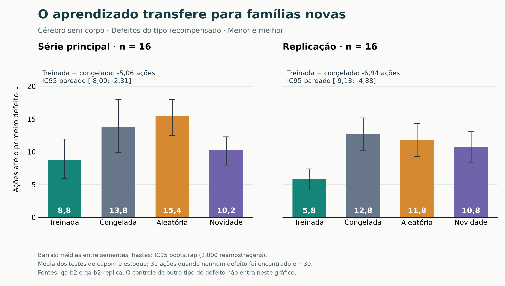

# Uma mosca-da-fruta simulada a partir do conectoma completo aprende a procurar defeitos de software

**Condicionamento dopaminérgico no corpo cogumelar de um modelo integra-e-dispara do Male CNS v1.0, do cérebro isolado a
um corpo em um mundo 3D**

Jonnas Figueiredo · versão de 12/10/2026 · *[English version](artigo.en.md)*

> **[Figura 1: visão geral.]** Sugestão: à esquerda, o cérebro 3D com as células de Kenyon e os neurônios de saída
> acesos; à direita, a mosca na arena 3D cheirando as três plaquinhas. Legenda: "O mesmo cérebro, sem corpo (bancada) e
> com corpo (arena)."

---

## Resumo

Simulamos o sistema nervoso central completo de um macho de *Drosophila melanogaster* (Male CNS v1.0, Janelia, 2026:
166.700 neurônios e 6,2 milhões de conexões), com neurônios integra-e-dispara (Shiu et al., 2024) e aprendizado por
depressão dopaminérgica das sinapses do corpo cogumelar. Cada ação de um sistema de software fictício é apresentada como
um cheiro; cada defeito encontrado é pareado com dopamina de recompensa. Perguntamos se o cérebro treinado passa a
priorizar, em partes do sistema que nunca viu, as ações que compartilham a característica recompensada.

**Cérebro sem corpo.** Num protocolo validado antes por simulação sem cérebro e por análise de poder, a mosca treinada
achou defeitos do tipo aprendido em famílias novas de ações 5,1 ações antes do controle de pesos congelados (IC95
[−8,0; −2,3], 16 sementes) e 6,9 ações antes na replicação ([−9,1; −4,9], 16 sementes). O efeito sobreviveu a 180 s de
outros cheiros, repetiu-se com outro tipo de defeito e resistiu à correção de Holm sobre 16 séries. Não ajudou num
defeito de outro tipo, a dissociação esperada de uma associação específica.

**Mosca com corpo.** Num corpo simulado que anda e cheira com as antenas numa arena 3D, o mesmo treino fez a mosca
escolher mais as ações do tipo recompensado em partes novas do sistema: +0,10 de fração de escolha (IC95 [0,05; 0,15],
p < 0,001, maior em 16 de 20 sementes), com a valência do cheiro premiado maior em 19 de 20. O tempo até o primeiro
defeito, critério principal escrito antes, não diminuiu de forma mensurável (−1,2 tentativas, [−5,9; 3,4]): a memória
muda as escolhas, mas pouco demais para encurtar a busca com 20 pares.

Relatamos todas as séries, incluindo 11 negativas, cada uma com a causa identificada, e separamos sempre o que emerge
da fiação medida do que é regra do modelo.

---

## 1. Introdução

### 1.1 Motivação

Conectomas completos permitem simular um cérebro inteiro a partir da fiação medida. Shiu et al. (2024) mostraram que um
modelo integra-e-dispara do cérebro adulto da mosca prevê circuitos de alimentação e de higiene sem ajuste por
neurônio. O Male CNS v1.0 estende o mapa ao sistema nervoso central inteiro de um macho.

A pergunta aplicada é deliberadamente lúdica: uma mosca simulada pode aprender a "caçar bugs"? A pergunta científica é
séria: o circuito de aprendizado associativo do corpo cogumelar, conectado como na mosca real, liga uma característica
abstrata de um estímulo a uma recompensa e transfere essa associação para estímulos novos que a compartilham? E isso
sobrevive quando o cérebro está num corpo, sentindo o mundo pelos próprios sentidos?

### 1.2 O corpo cogumelar

Cheiros ativam receptores olfativos agrupados em cerca de 50 glomérulos. Neurônios de projeção levam esse código às
~2.000 células de Kenyon (KCs) de cada lado, que respondem de forma esparsa (5–10% por cheiro; Honegger et al., 2011;
Lin et al., 2014). As KCs convergem sobre poucas dezenas de neurônios de saída (MBONs), em compartimentos inervados por
tipos distintos de neurônios dopaminérgicos (Aso et al., 2014). A dopamina de recompensa (PAM) ou de punição (PPL1)
deprime as sinapses KC→MBON ativas naquele momento (Hige et al., 2015), e isso muda a resposta àquele cheiro.

### 1.3 Contribuições

1. Um protocolo de treino e teste para um cérebro simulado a partir do conectoma, com controles pareados, critérios
   escritos antes e replicação.
2. A demonstração, no cérebro isolado, de aprendizado específico e de transferência por característica.
3. A mesma pergunta num corpo 3D: a memória transfere para as escolhas da mosca que anda e cheira.
4. Um diagnóstico de método útil além deste projeto: validar a bancada com um "oráculo" sem cérebro e com análise de
   poder antes de gastar simulações caras, e testar o condicionamento isolado antes de séries longas.
5. O registro completo dos resultados negativos e das suas causas.

---

## 2. O modelo

### 2.1 Visão geral

O modelo é fiel ao animal na **fiação** e simplificado no **neurônio**.

| Camada | O que é | Origem |
|---|---|---|
| Mapa | 166.700 neurônios, 6,2 milhões de conexões com 5+ sinapses; sinal pelo neurotransmissor previsto | Male CNS v1.0 |
| Neurônio | Integra-e-dispara com vazamento, passo de 0,25 ms, simulação por eventos | Shiu et al. (2024) |
| Sinapse | Peso proporcional ao número de sinapses | Mapa |
| Entradas | Trens de disparos nos neurônios sensoriais reais (receptores olfativos por glomérulo, açúcar das patas, LC10a) | Mapa + regra |
| Saídas | Taxa de neurônios de comando reais (direção DNa01–03, probóscide, fibra gigante, asas, MBONs) | Mapa |
| Aprendizado | Depressão KC→MBON pela dopamina | Regra (Hige et al., 2015) |

**Calibrações globais** (necessárias porque o mapa tem mais que o dobro de sinapses do de 2024; sem elas, o cérebro
dispara todo junto): ganho sináptico 0,5×; adaptação de 0,3 mV por disparo (τ 1 s); sem as conexões excitatórias PN↔LN
do lobo antenal; sem autapses; tônus de 6,8 mV nas MBONs e 7,3 mV nos DNa01–03. Nenhum peso individual foi ajustado
para produzir comportamento.

### 2.2 Aprendizado e memória

- **Rastro:** cada KC que dispara deixa um rastro de ~0,4 s ("quem estava sentindo o cheiro").
- **Recompensa:** os 222 PAM deprimem as sinapses das KCs com rastro para as MBONs de evitar (`mbon_evitar_rec`).
  Punição: os 12 PPL1 deprimem as sinapses para as MBONs de aproximar.
- **Tempo:** esquecimento de volta ao peso original (τ 90 s por padrão; 1 h nas medidas com corpo, seção 7),
  consolidação (cada episódio de dopamina deixa a mudança até 10× mais estável) e extinção (cheirar sem recompensa apaga
  mais rápido).
- **Controle principal:** o mesmo cérebro, com a mesma exposição e as mesmas recompensas, mas com os pesos parados
  (`plasticidade: false`).

**Leitura (regra):** valência = taxa de `mbon_aprox` − média(`mbon_evitar`, `mbon_evitar_rec`), em Hz por neurônio,
média de 1 s. O ruído dessa leitura com os pesos congelados é de 0,15 (desvio-padrão).

### 2.3 Quão próximo da mosca real

**Emergem da fiação** (triagens do próprio modelo): alimentação (açúcar nas patas → probóscide, primeiro sinal em
30 ms), orientação visual (LC10a → DNa02 do mesmo lado), fuga (ameaça em expansão → rajada da fibra gigante; DNp02,
DNp04 e DNp11 dão a direção) e aprendizado associativo específico do cheiro pareado.

**A memória, comparada à do animal:**

| | Mosca real | Modelo |
|---|---|---|
| Circuito KC→MBON, dopamina PAM/PPL1 | sim | sim, do mapa |
| Regra (depressão de sinapses ativas) | medida (Hige et al., 2015) | implementada |
| Compartimentos | ~15, com papéis distintos | agrupados em aproximar/evitar |
| Duração | horas (curto prazo) a dias (longo prazo) | esquecimento único configurável + consolidação |
| Extinção | memória nova, oposta (Felsenberg et al., 2018) | apaga a original |

**Limites:** neurônio de um compartimento, sem retina (a visão entra no LC10a por regra), sem neuromodulação ampla nem
junções elétricas, KCs mais esparsas que no animal (~3% por cheiro contra 5–10%). Em uma frase: o circuito e a regra de
aprendizado são os da mosca; os tempos da memória são simplificados. Não afirmamos que o modelo é uma mosca.

---

## 3. Método

1. **Critério antes da medida.** Cada série tem o critério escrito em `docs/plano-treino-robusto.md` e commitado no
   git antes de rodar; o histórico prova a ordem.
2. **Pareamento por semente.** As condições de uma semente veem a mesma sequência de ações visíveis, sorteada antes.
3. **Controles:** congelada (principal), escolha aleatória, explorador por novidade e um defeito de controle que a
   memória não deve ajudar a achar.
4. **Estatística:** diferença pareada por semente; IC95 por bootstrap percentil (2.000 reamostragens); p do mesmo
   bootstrap; dz.
5. **Replicação** com sementes novas; **correção de Holm** sobre a família de séries confirmatórias.
6. **Mudanças de desenho declaradas,** motivadas por diagnósticos independentes do resultado principal, com sementes e
   critério novos.
7. **Negativos publicados** com o mesmo detalhe.

Execução: o cérebro sem corpo roda no Node.js com o mesmo código da página (`web/sim-worker.js`); a mosca com corpo roda
na página, num Chrome sem janela, com os olhos reais. Rotinas automáticas executam escadas escritas antes, resumem,
anotam no plano e fazem o commit (`scripts/madrugada.mjs`, `scripts/madrugada_mundo.mjs`).

---

## 4. Tarefa: caça a bugs como condicionamento olfativo

**O sistema** (`web/qa/pedidos.js`): Pedidos em memória (estoque, carrinho, cobranças, cancelamentos, cupons), com
defeitos injetáveis por versão e um verificador de contratos que não sabe onde está o defeito (estoque entre 0 e o
inicial, conservação do estoque, uma cobrança por pedido, total finito e ≥ 0, sem quantidade negativa, desconto ≤ 30%).
A versão correta não gerou nenhum alarme falso em 90.000 ações aleatórias.

**Ações como cheiros (metáfora nossa):** as 15 ações combinam uma família (carrinho, estoque, pagamento, cancelamento,
cupom) e uma entrada (normal, zero, limite, negativa, repetida). Cada uma das 10 características é um par de
glomérulos, e o cheiro da ação é a união dos quatro, a 100 Hz nas duas antenas.

**Escolha e recompensa (regras):** a cada passo, 3 das 15 ações ficam visíveis; a mosca cheira cada uma por 1 s e
escolhe por softmax (T = 0,15) sobre a valência. Um contrato violado pela primeira vez (bug novo) é pareado com o cheiro
da ação e PAM a 100 Hz. Treino em versões com defeitos de repetição em pagamento e cancelamento; teste, sem recompensa,
em famílias novas (cupom duplo, reserva dupla) e num controle (quantidade negativa).

**Métrica principal:** ações até o primeiro bug nas versões de transferência (31 se não achou em 30); treinada −
congelada < 0.

> **[Figura 2: o protocolo.]** Sugestão: diagrama treino → teste, mostrando as famílias com defeito no treino e as
> famílias novas no teste, ligadas só pela característica "repetida".

---

## 5. Validação do aprendizado

**T0, cérebro isolado** (`t0-cerebro.json`, 3 sementes): pareado com dopamina, o cheiro A teve a resposta de
`mbon_evitar_rec` reduzida em 65% (−0,9 a −1,1 Hz) e a valência subiu de ~0,7 para ~1,4; o cheiro B não pareado e o
cérebro congelado não mudaram.

**T1, arena de dois cheiros com corpo** (20 sessões): preferência pela pista recompensada, treinada − congelada,
**0,74 (IC95 [0,65; 0,82], 5/5 sementes)**.

---

## 6. Resultados no cérebro sem corpo

### 6.1 Do negativo ao desenho validado

As cinco primeiras séries foram negativas. A investigação encontrou duas causas, ambas do desenho e não do cérebro:

| Causa | Evidência | Correção |
|---|---|---|
| Cheiros que acendiam poucas KCs | até 8 pareamentos subiam a valência só +0,1 a +0,2 (ruído); a ação premiada acendia 38 KCs | remapear a característica premiada para glomérulos fortes (DC1+VA6, ~90 KCs): **uma** recompensa passou a subir a valência +0,74 a +0,92 |
| Bancada sem sensibilidade | um oráculo sem cérebro mostrou que até uma memória perfeita só adiantaria 3,8 ações, e uma versão de teste era quase inalcançável | bancada 2: defeitos de repetição sem pré-condição, teste em famílias novas, controle de tarefa, teste sem recompensa |

A bancada 2 foi validada antes de qualquer rodada: no oráculo, aleatória 13,2 ações, memória perfeita 6,2, memória com o
ganho medido no cérebro 8,4–8,8; 16 sementes detectam o menor ganho medido em 92% das simulações.

### 6.2 Resultado principal: passou e replicou

Ações até o primeiro bug (menor é melhor), 16 sementes por série:

| Série | Treinada | Congelada | Aleatória | Novidade | Treinada − congelada (IC95) |
|---|---|---|---|---|---|
| Principal | **8,8** | 13,8 | 15,4 | 10,2 | **−5,06 [−8,00; −2,31]** |
| Replicação | **5,8** | 12,8 | 11,8 | 10,8 | **−6,94 [−9,13; −4,88]** |

- A valência das ações repetidas subiu +1,03 e +0,95; as outras ações e a congelada ficaram em ~0.
- A treinada escolheu uma ação repetida em 85% das oportunidades, contra 53% da congelada.
- **Dissociação:** no controle (defeito de outro tipo) a treinada não melhorou; piorou (+3,7 e +8,3). Ela aprendeu
  "repetição dá defeito", não "achar qualquer coisa mais rápido".

### 6.3 Robustez

| Extensão (16 sementes por série, com replicação) | Principal | Replicação |
|---|---|---|
| Retenção: 180 s de outros cheiros antes do teste | −4,8 [−8,3; −1,7] | −5,6 [−8,9; −2,5] |
| Outro tipo de defeito premiado ("normal") | −4,8 [−7,3; −2,4] | −5,1 [−8,0; −2,4] |
| Controle de cheiro: característica premiada com glomérulos fracos | −2,1 [−5,4; +1,3], negativo | — |
| Decepção (PPL1 quando a escolha promissora não acha bug), custo no controle | +6,3 [+1,7; +11,6] | +4,6 [−0,6; +10,6], **não replicou** |

Com Holm sobre as 16 séries confirmatórias, as 6 positivas que replicaram continuam significativas (p 0,007–0,011).

### 6.4 Linha de base e curiosidade

**Contra um aprendiz clássico** (Rescorla–Wagner com as mesmas informações): a mosca transfere melhor (−5,3
[−7,5; −3,2]) e fica perto do teto, como um aprendiz que só aprende com recompensa e generaliza por característica; paga
mais no defeito de outro tipo.

**Memória + habituação** (regra nossa: valência − 2,5 × tentativas da ação no episódio): empata com o explorador por
novidade na média de todos os defeitos (−0,2 e −0,3 ações; não-inferioridade pré-registrada, com replicação), ganha dele
nos defeitos do tipo aprendido (−1,6 e −2,1) e perde no de outro tipo (+2,7 e +3,5). Nesse arranjo, a contribuição
própria da memória ficou pequena.

---

## 7. A mosca com corpo no mundo 3D

### 7.1 Corpo e mundo

O corpo é a NeuroMechFly (flygym, MuJoCo), animado pelas saídas do cérebro: os descendentes de direção viram a mosca,
os motores das asas comandam o voo, a probóscide estende com açúcar nas patas. Cada olho tem 721 omatídeos e os campos
receptivos do LC10a vêm das sinapses. O mundo é uma bancada de cozinha em 3D; as 15 ações viram plaquinhas com o
cheiro das suas características.

> **[Vídeo 1: a mosca no mundo 3D.]** Sugestão: 30–60 s da mosca andando, subindo e voando entre as plataformas da
> cozinha, com o cérebro 3D acendendo ao lado.

### 7.2 Mundos de plataformas: negativos, com as causas

| Mundo | Resultado | Causa encontrada |
|---|---|---|
| Plataformas por família, andar e voar livres (20 pares) | negativo: fração das provas na característica premiada 0,26 (treinada) contra 0,28 (congelada), igual ao acaso (0,27) | em cima de uma plataforma ela prova todas as plaquinhas, e a característica premiada estava em 4 das 5 plataformas: a memória não tinha onde virar escolha |
| Plataformas por característica (6 calibrações) | treino sem recompensa suficiente (≤ 3 de 9 versões com bug) | o formato das plataformas e uma **aversão inata ao cheiro DC1+VA6** (0% do tempo na plataforma com esse cheiro; 16% com o mapa trocado), vinda do cérebro, decidiam para onde ela ia |

### 7.3 Arena de escolha e o diagnóstico por condicionamento

Para isolar a escolha, seguimos o desenho dos testes de memória com moscas reais (T-maze, arenas de escolha) e o da
bancada: a cada tentativa, 3 plaquinhas no chão em volta do centro (as mesmas ações visíveis da bancada para a mesma
semente). A mosca anda até cada uma (**regra:** o caminho até a próxima soma uma virada para ela), para 1,5 s em cima
cheirando com as antenas (a valência é a média dos MBONs no último 1 s) e, depois das três, a escolha pela regra da
bancada acende a escolhida, que ela prova com a probóscide.

A primeira série na arena (20 pares) foi negativa (+0,5 tentativas [−3,6; +4,7]). Antes de qualquer série nova, testes
curtos de condicionamento no mundo (`qa_condicionamento.mjs`: a mosca parada em cima de uma plaquinha, 3 pareamentos,
valência medida antes e depois) acharam as causas:

| Condição (2 sementes cada) | Mudança da valência 20 s depois | 200 s depois |
|---|---|---|
| Mapa de cheiros trocado (o usado), esquecimento 90 s | +0,11 / +0,08 | −0,13 / −0,03 |
| **Cheiros fortes, esquecimento 1 h** | **+0,83 / +0,93** | **+0,57 / +0,86** |
| Cheiros fortes, esquecimento 90 s | +0,68 / +0,53 | +0,24 / +0,26 |
| Congelada | −0,16 a +0,07 | −0,06 a +0,15 |

O cheiro nas antenas no pareamento era o da bancada (98 Hz nos quatro glomérulos); a visão e o gosto doce foram
descartados como causa. O mapa trocado também quase não aprende no cérebro sem corpo (+0,03). Correções: cheiros
fortes (como na bancada) e esquecimento de 1 h (parâmetro do modelo, declarado; moscas reais lembram de uma recompensa
de açúcar por horas). Uma mini-arena de 4 pares mostrou escolha maior em 3 de 4 sementes antes da série longa.

> **[Figura 4: a arena.]** Sugestão: vista de cima da bandeja com as três plaquinhas e o caminho da mosca numa
> tentativa (cheirar, cheirar, cheirar, provar).

### 7.4 Resultado com corpo (arena 2, 20 pares, critério escrito antes)

Protocolo da bancada 2 (treino de 6 versões × 20 tentativas; teste em 3 versões novas, sem recompensa, até o primeiro
bug ou 30 tentativas), cheiros fortes, esquecimento de 1 h, sementes 1601–1620.

| Treinada − congelada | Diferença | IC95 | p | dz | Sementes a favor |
|---|---|---|---|---|---|
| Tentativas até o primeiro bug na transferência (**principal**) | −1,15 | [−5,92; +3,40] | 0,65 | −0,11 | — |
| **Escolha da característica premiada quando visível** | **+0,10** | **[+0,05; +0,15]** | **< 0,001** | **0,81** | **16 de 20** |
| Valência das opções premiadas no teste | +0,13 | [+0,09; +0,18] | — | — | 19 de 20 |
| Controle (não deve melhorar) | +2,5 | [−1,95; +6,95] | 0,31 | 0,24 | — |
| Bugs achados no treino | +0,2 | [−0,95; +1,30] | 0,74 | — | — |

- **O critério principal não passou.** A treinada não achou o primeiro bug novo mais cedo de forma mensurável.
- **A memória transferiu para as escolhas:** em partes do sistema que nunca viu, a mosca com corpo escolheu mais as
  ações do tipo recompensado (0,36 contra 0,26), e o cérebro dela deu mais valor a esse cheiro. As duas condições
  receberam a mesma quantidade de recompensa no treino.
- Este segundo resultado era secundário no registro; para contar como achado próprio precisa de uma série
  confirmatória em que seja o principal, com replicação.

> **[Figura 5: escolha com corpo.]** Sugestão: pontos pareados por semente (treinada × congelada) da fração de escolha
> da característica premiada, com a linha y = x.
>

[Assista ao vídeo: funcionalidades em ação](videos/funcionalidades-arena.mp4) — 24 s, 720p, modo escuro; reprodução em aproximadamente 1,5× o tempo da gravação.

### 7.5 Por que o efeito é menor com corpo

| | Bancada sem corpo | Arena com corpo |
|---|---|---|
| Valência do premiado depois do treino | +1,03 | +0,13 |
| Escolha do premiado | 85% contra 53% | 36% contra 26% |
| Ritmo | ~5 s por escolha | ~20 s por tentativa |
| Fundo dos outros sentidos | nenhum | olhos, tato, patas (KCs ~140 Hz de fundo) |

Logo depois de uma recompensa, a valência sobe tanto quanto na bancada (+0,8 a +0,9). Ao longo da sessão, o ritmo mais
lento, as muitas cheiradas sem recompensa (que a extinção do modelo apaga) e o fundo dos outros sentidos reduzem o
ganho médio. Com o efeito menor, a escolha melhora, mas pouco demais para encurtar o tempo até o defeito com 20 pares.

---

## 8. Discussão

### 8.1 O que se pode afirmar

- **O circuito aprende de forma específica,** com uma única recompensa, e transfere a associação por característica.
- **Sem corpo,** essa transferência faz a mosca achar defeitos do tipo aprendido 5–7 ações antes, de forma robusta
  (retenção, outro tipo de defeito, replicação, Holm), com custo num defeito de outro tipo.
- **Com corpo,** a transferência aparece nas escolhas da mosca que anda e cheira (p < 0,001, 16 de 20 sementes), mas o
  ganho de tempo não foi demonstrado.
- **A força da pista importa:** cheiros que recrutam poucas KCs quase não aprendem, com e sem corpo.

### 8.2 Lições de método

- Um negativo pode vir do desenho, não do cérebro: a codificação dos estímulos, a sensibilidade da tarefa e, com corpo,
  o desenho do mundo esconderam efeitos que existiam.
- Validar a bancada com um oráculo sem cérebro, uma análise de poder e um teste curto de condicionamento **antes** das
  séries longas teria economizado dias de simulação.
- Um mundo com corpo traz vieses que o cérebro isolado não tem: aversões inatas, atração pela luz, geometria dos
  objetos. Eles precisam ser medidos e controlados como qualquer outra variável.

### 8.3 Ameaças à validade

- **Vários desenhos testados.** Mitigado por critérios escritos antes, sementes novas a cada mudança, replicação e
  Holm, mas o risco de um "jardim de caminhos que se bifurcam" existe e está documentado passo a passo.
- **Regras nossas no caminho:** ações como cheiros, leitura da valência, softmax e, com corpo, o caminho guiado na
  arena. O resultado mostra que o circuito do mapa **suporta** a transferência sob essas regras, não que uma mosca real
  caçaria bugs.
- **Mesmo conectoma em todas as sementes:** não há variabilidade entre indivíduos.
- **Parâmetro de esquecimento** alterado para as medidas com corpo (90 s → 1 h), declarado e motivado por um teste de
  condicionamento.
- **Utilidade prática limitada:** como testador, a mosca não supera um explorador por novidade na média dos defeitos.

### 8.4 Próximos passos

1. **Confirmar o efeito com corpo** numa série em que a escolha seja o critério principal, com replicação.
2. **Memória mais fiel:** compartimentos reais do corpo cogumelar e extinção como memória oposta (Felsenberg et al.,
   2018), validados primeiro sem corpo.
3. **Aumentar o efeito com corpo** (mais ações visíveis, treino mais longo) para tentar ganhar tempo de busca.
4. **Software real** com defeitos gerados por testes de mutação; defeitos de sequência; memória entre sessões.

### 8.5 Conclusão

Num modelo do sistema nervoso central completo de uma *Drosophila* macho, o circuito do corpo cogumelar, condicionado
com dopamina a cada defeito encontrado, aprende a característica das ações que revelaram defeitos e a transfere para
partes de um sistema que nunca viu. Sem corpo, isso encurta a busca de forma robusta e replicada. Num corpo que anda e
cheira, a mesma memória muda as escolhas da mosca, mas ainda não o bastante para encurtar a busca.

Não afirmamos que uma mosca real procuraria defeitos, que o modelo é uma mosca, nem que o método é melhor que testes
convencionais. Afirmamos que a fiação medida de um cérebro real, com neurônios simplificados, sustenta aprendizado
associativo e transferência numa tarefa que nada tem de natural para ela, e relatamos onde isso funciona e onde ainda
não.

---

## 9. Reprodutibilidade

| O quê | Como |
|---|---|
| Dados do cérebro | `web/data/`, gerados de male-cns.janelia.org por `scripts/01_filter_edges.py` e `02_build_web.py` |
| Validação do cérebro (T0) | `node scripts/t0_cerebro.mjs 29,101,202` |
| Série sem corpo | `node scripts/qa_abstrato.mjs --bancada 2 --sementes 51,52 --cheiros docs/medicoes/qa-cheiros-fortes.json --saida docs/medicoes/X.json` |
| Resumo pareado e Holm | `node scripts/qa_resumo.mjs --prefixo X`; `node scripts/qa_comparacoes.mjs` |
| Oráculo e linha de base | `node scripts/qa_oraculo.mjs --bancada 2`; `node scripts/qa_linha_base.mjs` |
| Condicionamento com corpo | `node scripts/qa_condicionamento.mjs --cond ativa --esquecimento 3600 --semente 11` (página servida por `python scripts/servir.py`) |
| Série com corpo (arena) | `node scripts/madrugada_mundo.mjs --arena --n 20 --paralelos 2` |
| Registro cronológico | `docs/plano-treino-robusto.md`; cada medida em `docs/medicoes/`, com o método dentro |

Passo a passo: [docs/MANUAL.md](../MANUAL.md).

---

## 10. Referências

*(conferir dados bibliográficos completos antes de submeter)*

- Aso, Y. et al. (2014). The neuronal architecture of the mushroom body provides a logic for associative learning.
  *eLife* 3, e04577.
- Felsenberg, J. et al. (2017). Re-evaluation of learned information in *Drosophila*. *Nature* 544, 240–244.
- Felsenberg, J. et al. (2018). Integration of parallel opposing memories underlies memory extinction. *Cell* 175,
  709–722.
- Hige, T. et al. (2015). Heterosynaptic plasticity underlies aversive olfactory learning in *Drosophila*. *Neuron* 88,
  985–998.
- Holm, S. (1979). A simple sequentially rejective multiple test procedure. *Scand. J. Stat.* 6, 65–70.
- Honegger, K. S. et al. (2011). Cellular-resolution population imaging reveals robust sparse coding in the
  *Drosophila* mushroom body. *J. Neurosci.* 31, 11772–11785.
- Lin, A. C. et al. (2014). Sparse, decorrelated odor coding in the mushroom body enhances learned odor discrimination.
  *Nat. Neurosci.* 17, 559–568.
- Rescorla, R. A., Wagner, A. R. (1972). A theory of Pavlovian conditioning. Em *Classical Conditioning II*, 64–99.
- Shiu, P. K. et al. (2024). A *Drosophila* computational brain model reveals sensorimotor processing. *Nature*.
- Tully, T., Quinn, W. G. (1985). Classical conditioning and retention in normal and mutant *Drosophila
  melanogaster*. *J. Comp. Physiol. A* 157, 263–277.
- Tully, T. et al. (1994). Genetic dissection of consolidated memory in *Drosophila*. *Cell* 79, 35–47.
- Male CNS v1.0. HHMI Janelia FlyEM (2026). https://male-cns.janelia.org
- NeuroMechFly / flygym 2.1 (EPFL).
